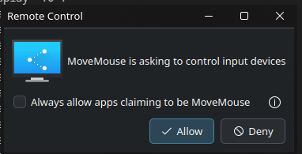

# About
Move Mouse is a simple piece of software that is designed to simulate user activity.

Originally designed to prevent Windows from locking the user session or going to sleep, Move Mouse can be deployed in a wide range of [Scenarios](https://github.com/sw3103/movemouse/wiki/Scenarios).

This port targets **.NET 10 (`net10.0`)** and **Linux** using **Avalonia UI**.


# Linux & .NET 10 Port

## What Changed
- **Runtime & UI**: Migrated from .NET Framework 4.7.2 / WPF to `.NET 10` (`net10.0`) with `Avalonia 11.2.5`.
- **Platform Services (`Move Mouse/Platform/`)**: Replaced Win32/WPF interop with native Linux integrations:
  - **Mouse & Keyboard Input**: Uses X11/XTest (`libX11`, `libXtst`), `/dev/uinput` (when accessible, particularly on Wayland), and CLI fallbacks (`ydotool` / `xdotool`).
  - **Idle Detection**: Uses X11 ScreenSaver extension (`libXss`) and session idle fallback.
  - **Power, Session Lock & Audio**: Reads `/sys/class/power_supply` for battery/AC status, monitors desktop session lock state, and adjusts default volume via `wpctl` / `pactl`.
  - **Desktop Integration**: Manages autostart via `~/.config/autostart`, opens URLs/scripts via `xdg-open`, shows desktop notifications via `notify-send`, and stores settings/logs under XDG config/data directories.
- **Controls & System Tray**:
  - Single-click the center mouse icon (or use the tray menu **Start / Stop** entry) to start/stop Move Mouse; right-click the center icon to open Settings.
  - Hover over the center ring to reveal the circular menu (Minimise, Settings, Donate, Twitter, Help, Close).
  - Single-click the system tray icon to show/activate the window, or **double-click** the tray icon to toggle **Start / Stop**.

## Stealth Mode Notice (Wayland / KDE Plasma)
When **Move Mouse Cursor** runs in **Stealth Mode** (or sends synthetic XTest/XWayland input events on Wayland compositors such as KDE Plasma), the desktop environment may display a **Remote Control** authorization dialog asking to allow MoveMouse to control input devices:



Check **Always allow apps claiming to be MoveMouse** and click **Allow** so stealth/simulated input continues working without repeated prompts.

## Build, Run & Test
Requires the **.NET 10 SDK** on Linux:

```bash
# Restore and build (Release)
dotnet build "Move Mouse/Move Mouse.csproj" -c Release

# Run the application
dotnet run --project "Move Mouse/Move Mouse.csproj" -c Release

# Run unit and Avalonia headless tests
dotnet test "Move Mouse.sln"
```

# Donate
Move Mouse will always be free, but if you would like to buy me a beer to show your appreciation, you can do so using the following link. Thanks!

[PayPal Donate](https://www.paypal.com/cgi-bin/webscr?cmd=_s-xclick&hosted_button_id=QZTWHD9CRW5XN)

# Wiki
Head over to the [Wiki](https://github.com/sw3103/movemouse/wiki) where you will find a bunch of articles for [Installation](https://github.com/sw3103/movemouse/wiki/installation), [Troubleshooting](https://github.com/sw3103/movemouse/wiki/troubleshooting), etc.

# Contact
Please feel free to contact me via [Twitter](https://twitter.com/movemouse) or [email](mailto:contact@movemouse.co.uk) for any suggestions or issues you may have. A lot of the features which are included in Move Mouse today exist because of feedback I have received.
